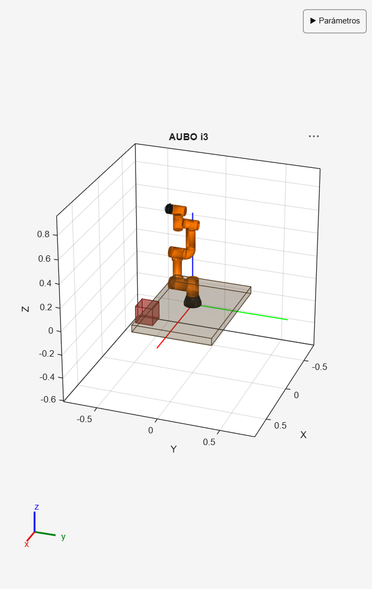
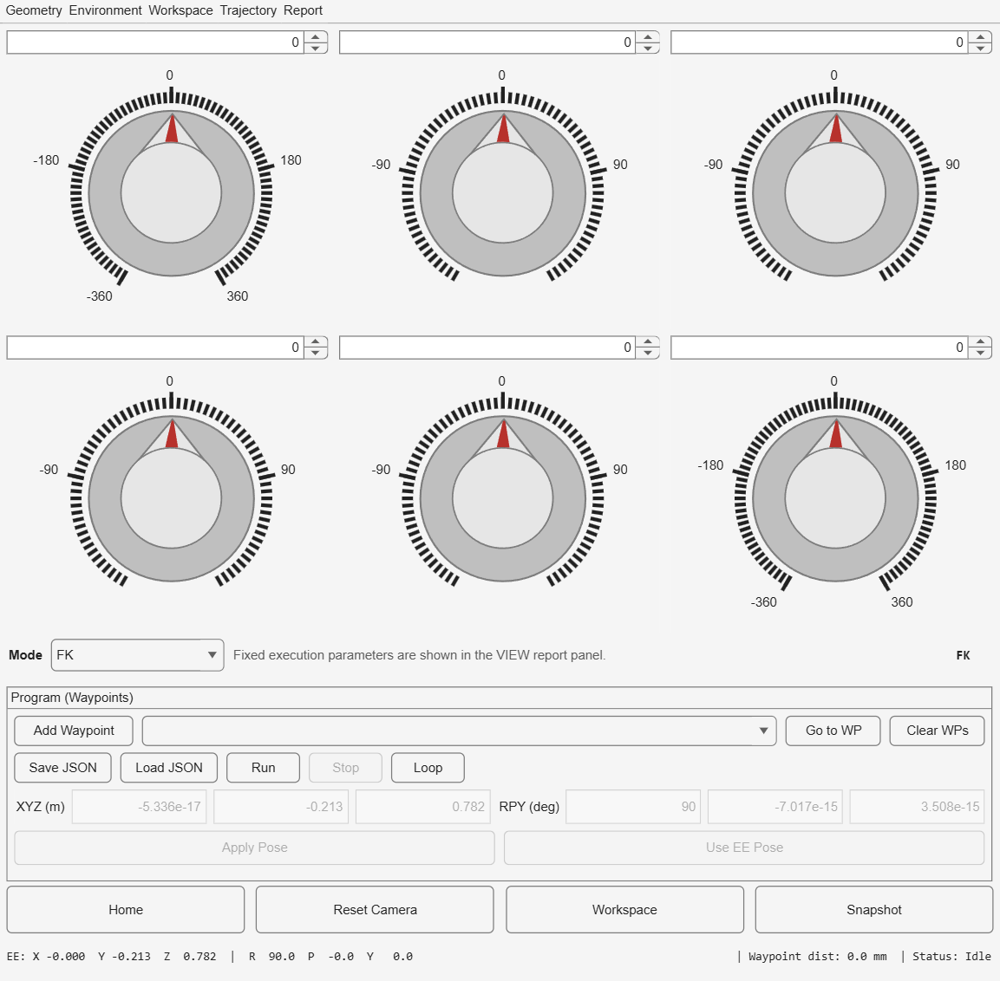

# AUBO i3

Aplicación para explorar la cinemática y programar recorridos de un robot AUBO i3 en un entorno virtual.

## Instalación

1. [Descarga la app para Windows](https://github.com/antoniogallardom/Actividad_MATLAB_Aubo_i3/raw/refs/heads/main/AUBO_i3_App_Windows.zip) y extrae el ZIP.
2. Ejecuta **Instalar_AUBO_i3.exe** y sigue las instrucciones del instalador.
3. Abre **AUBO_i3.exe** desde la ubicación de instalación.

La aplicación funciona sin instalar MATLAB ni disponer de sus toolboxes. Requiere **MATLAB Runtime R2026a**, que el instalador descarga durante la instalación si es necesario. Necesitarás conexión a Internet para esa descarga. El primer arranque puede tardar mientras se prepara el entorno de ejecución.

Esta distribución contiene la aplicación compilada para Windows; no incluye archivos de código fuente `.m`.

## Primeros pasos

La aplicación abre dos ventanas: **View**, con el robot y su entorno, y **Controls**, con los mandos y mensajes de estado.

- Selecciona **FK** para modificar las articulaciones o **IK** para introducir una pose del efector.
- Usa **Add Waypoint** para registrar puntos y **Run** para ejecutar el programa.
- Usa **Load JSON** para cargar uno de los programas de ejemplo incluidos o un programa guardado previamente. **Save JSON** guarda tus puntos.
- En **Environment** puedes configurar obstáculos. Revisa el mensaje **Status** y las advertencias visuales cuando una operación no sea admisible.
- En **Workspace** puedes calcular y visualizar el mapa de posiciones del efector. El cálculo puede tardar según el número de muestras.
- Usa **Home** para volver a la configuración inicial y **Reset Camera** para recuperar la vista.

## Archivos del usuario

Los mapas calculados se guardan en `%LOCALAPPDATA%\AUBO_i3\workspace`. Los programas JSON se guardan donde elijas en el diálogo de guardado.

Si el inicio falla, revisa si existe el registro `%LOCALAPPDATA%\AUBO_i3\error_inicio.log` e inclúyelo al informar del problema.

## Cómo citar el proyecto

El [registro de Zenodo](https://doi.org/10.5281/zenodo.16934109) reúne las versiones archivadas del proyecto y permite exportar la cita en BibTeX y otros formatos.

- **DOI general del proyecto:** [10.5281/zenodo.16934109](https://doi.org/10.5281/zenodo.16934109).
- **Versión archivada de agosto de 2025:** [10.5281/zenodo.16934110](https://doi.org/10.5281/zenodo.16934110).

La aplicación para Windows que se descarga desde este repositorio es posterior a esa versión archivada y todavía no tiene una nueva versión publicada en Zenodo. Para citar resultados obtenidos con ella, identifica también el commit de GitHub utilizado; cuando se archive una nueva versión, utiliza su DOI específico.

## Proyecto y licencia

Autor: Antonio Gallardo Montti.

[GitHub](https://github.com/antoniogallardom/Actividad_MATLAB_Aubo_i3) · [File Exchange](https://la.mathworks.com/matlabcentral/fileexchange/181858-actividad-matlab-aubo-i3)

Distribuido bajo la licencia BSD de dos cláusulas incluida en [LICENSE](LICENSE).

